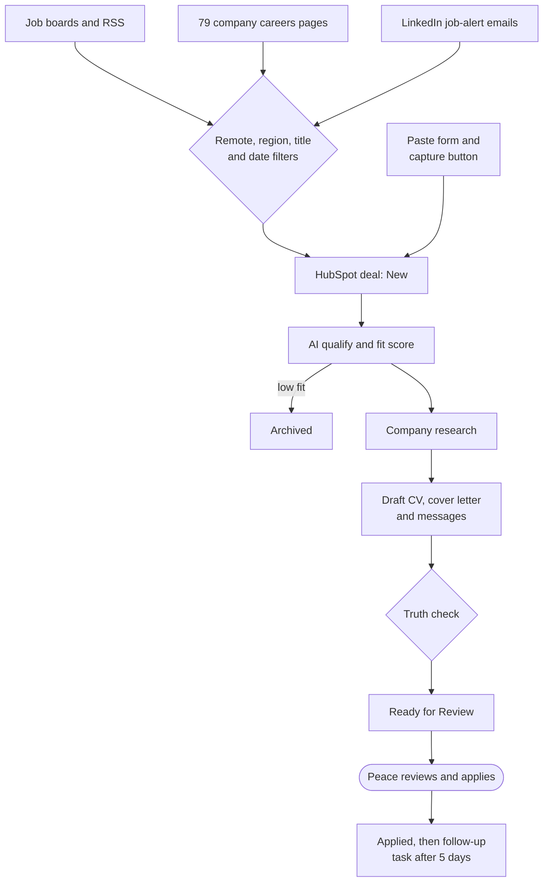

# GTM Job Engine

**A human-in-the-loop system that finds remote Go-to-Market (GTM) roles, scores fit, researches the company and drafts tailored, ATS-friendly applications for review in HubSpot.**

> Status: ✅ **Build complete (25 Nov 2026).** All nine milestones are built. The system runs on schedules every day; live use (M7) and the 15-a-day target (M9) are being validated with real applications. See [roadmap](#roadmap).

---

## The problem

Quality job applications are slow. Each one means finding roles that are *truly* remote worldwide, judging fit, researching the company and the person hiring, and tailoring a CV so AI screening ranks it highly. Done by hand, one application took **120 minutes** ([baseline](docs/baseline.md)). Sending generic applications at scale doesn't work either: they score poorly and get ignored.

Working from Nigeria adds a filter most job tools ignore: many "remote" GTM roles are remote *within the US* only.

## The approach

Automate the repetitive research and drafting. Keep a human in charge of every irreversible step.



Schedules run on GitHub Actions; a daily digest, a Monday summary and failure alerts arrive by email.

Every job is a HubSpot deal, and every step moves it by changing its stage. The CRM doubles as the review queue.

## Design decisions

| Decision | Why |
|---|---|
| **Human approves anything irreversible** | No auto-apply, no auto-send. The system drafts; a person decides. |
| **No LinkedIn automation** | Respects platform rules and protects the account. Poster details come from the post URL itself; job-alert emails are read from Gmail; LinkedIn pages are never fetched. When an alert's job isn't on the company's own board, the deal asks for the description to be pasted. |
| **Truth-only CV tailoring** | The AI picks and rewords facts from a master CV by ID; code rebuilds the CV from the master and drops anything it can't trace. A separate truth-check pass compares every changed line with its source. |
| **AI reads, code decides** | The AI extracts facts and judges skills overlap; hard filters and the fit-score rubric are plain code, so every score has a readable breakdown (`remote 20 \| title 25 \| skills 15 \| seniority 7`). |
| **Data minimisation** | Contact details are never sent to the AI. Emails, phones and profile links are redacted from job text, and each prompt gets only the CV sections it needs (no contact section, no employer names for scoring). |
| **Diagnose with data, then tune** | When 19 of 20 jobs were being archived, a read-only archive report showed why (skills judged without seeing experience; senior roles scoring zero). The fix was measured on the same jobs before going live. |
| **Widen the funnel, not the noise** | Public APIs, RSS and company boards only (never scraped pages), each with title, remote-eligibility and recency filters. New boards, companies and titles are config edits, not code changes. |
| **Lean CRM model** | HubSpot's free CRM allows 10 custom properties, so the model uses 9 and keeps everything else in built-in fields, notes and attachments. Setup is idempotent and checks the limit first. |
| **Safe re-runs, loud failures, dry runs** | Unique keys prevent duplicates; failed scheduled runs email an alert; a busy AI pauses work instead of failing; every step has a preview or dry-run mode with made-up data. |
| **Resilient on free tiers** | Gemini free tier with backup models when the main one is overloaded, request pacing, and polite per-site spacing for job boards. The provider can be switched to Claude in config. |

## What it does each day

| When (Lagos time) | What runs |
|---|---|
| 06:17 and 14:17 | Import from job boards, 79 company boards and LinkedIn alert emails, then qualify, research and draft |
| Every 2 hours, 07:47-21:47 | Process captured posts: qualify, research, draft |
| 07:27 | Daily digest email: jobs ready for review, follow-ups due, anything that needs attention, failed runs |
| Monday 08:07 | Weekly summary: funnel numbers, draft quality, and progress towards 5 and 15 applications a day |

## Stack

Python 3.12 · HubSpot free CRM (Service Key) · Gemini API (free tier, switchable to Claude) · Cloudflare Workers · GitHub Actions · Gmail (SMTP and read-only IMAP) · python-docx

## Results so far

All numbers are measured, not estimated.

- **Baseline:** one application done fully by hand took **120 minutes**, about 75% of it on research, CV tailoring, the cover letter and outreach messages: the steps the system now drafts. ([details](docs/baseline.md), sample of 1)
- **Supply:** one import run reads **4,000+ job postings** across the boards and company careers pages; a dry run on 24 Nov 2026 kept **57** that matched the title, remote and region filters (up from 13 before the target-company list and title review).
- **Scoring fix:** before the fix, **19 of 20** incoming jobs were archived. Re-scoring the 15 low-score jobs after the fix qualified **9**, including the core GTM Engineer and Marketing Automation roles, while weak-fit roles stayed archived.
- **Drafting:** the first live draft passed the truth check with **100% keyword coverage**, attached to the HubSpot deal as a two-page ATS CV and a cover letter.
- **Quality checks:** **323** Python tests and **39** Worker tests run on every push.

Application volume, time per application after launch and interview results will be added from real data as they come in.

## Repository layout

```
config.yaml          titles, regions, rubric, goals, caps, sources, companies, models (no personal data)
docs/                PRD, runbook, baseline, target companies, job-board review, portfolio material
prompts/             version-controlled AI prompts (qualify, research, draft, truth check)
src/                 pipeline modules (intake, sources, qualify, research, draft, render, digest)
templates/           ATS-safe CV and cover letter templates (.docx)
scripts/             runnable steps and checks (each has --offline / --preview / --dry-run)
worker/              Cloudflare Worker: paste-a-link form, capture endpoint, bookmarklet
tests/fixtures/      made-up sample data only
.github/workflows/   schedules, manual runs and CI
```

## Roadmap

| # | Milestone | Status |
|---|---|---|
| M0 | Foundations: repo, config, rubric, ATS CV template | ✅ Done |
| M1 | HubSpot pipeline and properties setup | ✅ Done |
| M2 | Manual baseline (timed by hand) | ✅ Done (1 application) |
| M3 | Intake: job boards, capture bookmarklet, paste-a-link form | ✅ Done |
| M4 | Qualify and research | ✅ Done |
| M5 | Draft: tailored CV, cover letter, messages, truth check | ✅ Done |
| M6 | Operations: schedules, digest, alerts, dry run | ✅ Done |
| M7 | Go live: target companies, LinkedIn alerts, scoring tuned on real jobs | ✅ Built · validating (5 a day for 5 days) |
| M8 | Portfolio: case study, diagram, demo script, posts | ✅ Built · publishing |
| M9 | Hold 15 a day: caps, daily goal tracking in the weekly summary | ✅ Built · validating (15 a day for 5 days) |

## Running locally

```bash
python -m venv .venv
.venv\Scripts\activate          # Windows
pip install -r requirements.txt
python -m pytest
python scripts/import_jobs.py --dry-run --offline   # made-up board data, fake HubSpot
python scripts/qualify_jobs.py --offline            # made-up jobs, fake AI
python scripts/draft_jobs.py --offline              # writes sample drafts to output/
python scripts/send_digest.py --offline             # prints a sample digest
```

The [runbook](docs/runbook.md) covers setup, secrets, daily use and troubleshooting.

## Privacy

This repository contains no personal data. The master CV and all keys live in GitHub Secrets and Cloudflare secrets. Test fixtures use made-up people and `example.com` addresses. Public run logs show counts, scores and job titles only.

---

Built by Peace George, GTM engineer and growth strategist.
